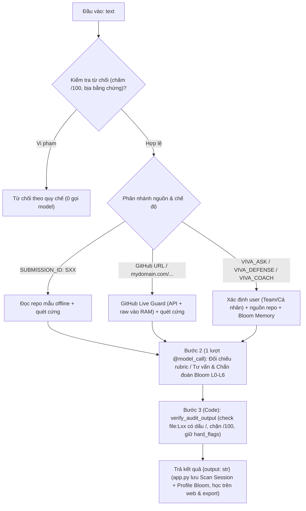

# Spec gom Hướng 1 + Hướng 2 — Giám khảo ảo Free2Play (Track A · A6)

> **Trạng thái:** ĐÃ KHOÁ SPEC (LOCKED · 28/11/2026 00:20) trên nhánh `develop-tuan` — Sẵn sàng triển khai theo 2 chặng CP3 → CP4  
> **Cập nhật theo:** `main` tại commit `0edbd65` (25 câu `S01–S25`) · **Mục tiêu:** Nâng cấp từ bản rà soát file mẫu offline thành công cụ soi link GitHub thật (`mydomain.com/<link_repo>`), phỏng vấn vặn ngược theo thành viên (chẩn đoán Bloom L0–L6 + hồ sơ học xuyên suốt) và học trực tiếp trên web kèm Export đa định dạng.

---

## 1. Trạng thái & Mục tiêu (Vì sao gộp Hướng 1 + Hướng 2)

Nếu sản phẩm chỉ đọc vài file `.md` rồi nhận xét chung chung, người dùng chỉ cần dán bài vào Claude Code, Cursor hay ChatGPT là xong. Số liệu thật của chính nhóm trong `spec.md` §1, §3 và `evidence/summary.md` (`N = 135` repo công khai CP1 + khảo sát `n = 25` học viên) đã chứng minh rõ 2 điểm mù lớn mà các AI chat thông thường không giải quyết được:

1. **AI chat mù trạng thái thật trên GitHub (lý do chọn Hướng 1):**
   - Khảo sát ghi nhận **13/25 (52%)** học viên từng PR/push nhầm repo gốc BTC (`GIT-FORK-PR`).
   - Đáng chú ý, trong nhóm **15 người đã tự dán bài vào AI ngoài**, vẫn có **11/15 (73,3%)** gặp lỗi sát giờ và **6/15 (40%)** vẫn PR nhầm repo gốc vì AI chat chỉ đọc văn bản được dán, không nhìn thấy trạng thái Git/GitHub sống.
2. **AI chat hay xu nịnh và nói hộ đáp án (lý do chọn Hướng 2):**
   - Khảo sát ghi nhận **6/25 (24%)** học viên từng lúng túng khi bị hỏi vặn trước buổi chấm; theo quy chế khoá học, thành viên không giải thích được phần mang tên mình sẽ nhận **0 điểm phần đó**.
   - Các trợ lý AI thông thường thường khen cho vừa lòng hoặc tự viết hộ câu trả lời mẫu, khiến học viên chủ quan đến khi ra demo bị vặn chéo số liệu thực tế trong repo.

**Tóm tắt giá trị gộp 1 + 2:** Dán 1 link repo công khai → **code Python** soi thẳng các lỗi GitHub thật mà AI chat không thấy → **AI** đóng vai giám khảo khó tính gọi đúng tên từng thành viên trong `TEAMS.md` để hỏi xoáy và bắt bẻ lại bằng số liệu thật trong chính repo đó.

---

## 2. Ràng buộc bất biến (Không phá luật CP2 & khung BTC)

- **Khoá cứng chuẩn CP2:** Tuyệt đối **không sửa** `spec.md` §7 (chuẩn "đạt") và `eval/metric_spec.yaml` đã chốt lúc 19:30 Thứ Sáu 27/11; không sửa 4 file khung BTC (`run.py`, `codebase/tracing.py`, `eval/run_eval.py`, `cost/simulate.py`).
- **Giữ nguyên hợp đồng luồng chính:** `answer(text: str) -> {"output": str}` trong `codebase/agent.py` (1 lượt gọi `@model_call` mỗi phiên, luồng cố định 3 bước).
- **Tách bạch offline cho chấm điểm tự động:** Toàn bộ bộ câu thử `S01..S25` chạy qua `py run.py eval` và `py run.py simulate` phải chạy **100% offline/local** (không gọi mạng GitHub API trong lúc chạy eval/simulate) để tránh chạm trần 60 request/giờ của GitHub và đảm bảo kết quả chạy lặp lại giống nhau.
- **Giữ nguyên giới hạn an toàn:**
  - `NO-AUTO-GRADE`: Không tự chấm điểm cuối (`/100`), không kết luận đậu/rớt thay Lab Coach/giám khảo.
  - Chỉ đọc tĩnh dữ liệu (không thực thi code bất kỳ trong bài nộp).
  - Không ghi, không lưu vĩnh viễn và tuyệt đối không commit code của đội khác xuống đĩa.
- **Nhật ký thay đổi:** Khi chính thức chốt để triển khai code, mọi thay đổi bổ sung sẽ được ghi đầy đủ vào bảng changelog `spec.md` §10.

---

## 3. Hướng 1 — Dán link `mydomain.com/<link_repo>` soi trạng thái thật trên GitHub

### 3.1. Đầu vào hỗ trợ
- **Link GitHub trực tiếp:** `https://github.com/owner/repo` hoặc `github.com/owner/repo`.
- **Kiểu gõ thẳng trên thanh địa chỉ web (URL-hack tương tự `gitingest`):**
  - `mydomain.com/owner/repo`
  - `mydomain.com/https://github.com/owner/repo`
- **Chế độ offline cũ giữ nguyên:** `SUBMISSION_ID: S01..S25` (dùng cho bộ câu thử local và khi chạy `eval`/`simulate`).

### 3.2. Bốn lớp kiểm tra bằng code Python thuần (`urllib.request`, 0 thư viện ngoài)
1. **Công khai / ẩn danh (`PUBLIC-ACCESS`):**
   - Gọi `GET /repos/{owner}/{repo}` kiểm tra `private == false`.
   - Nếu gặp `404` hoặc `403` (repo đang để Private hoặc sai link), báo ngay cờ G10: *"CHƯA KIỂM ĐƯỢC — Không truy cập được ở chế độ công khai (có thể repo đang Private hoặc sai đường dẫn)"*.
2. **Fork & PR nhầm repo gốc BTC (`GIT-FORK-PR`):**
   - Kiểm tra cờ `fork` và `parent.full_name` từ API repo.
   - Nếu là repo fork từ repo đề, gọi thêm `GET /repos/{parent}/pulls?state=open` và lọc theo `head.user.login == owner` để bắt ngay các PR đang mở nhầm về repo gốc BTC; cảnh báo lộ bài và hướng dẫn đóng PR / tách sang repo độc lập.
3. **Chống sửa luật sau mốc chốt CP2 19:30 (`PENALTY-STANDARD` — 0 điểm khối R4):**
   - Gọi `GET /repos/{owner}/{repo}/commits?since=2026-11-27T12:30:00Z` (tương ứng 19:30 giờ Việt Nam UTC+7) lọc trên các file `eval/metric_spec.yaml`, `spec.md`, `eval/benchmark.csv`.
   - So sánh commit gần nhất sau mốc chốt với phiên bản ngay trước mốc 19:30: bật cờ đỏ kèm mã commit (`SHA`) và thời gian nếu phát hiện sửa `eval/metric_spec.yaml`, sửa nội dung mục `§7` trong `spec.md`, hoặc xoá câu thử / sửa cột `expected` trong `eval/benchmark.csv`. *(Việc thêm mới câu thử vào cuối `eval/benchmark.csv` cho mốc CP3 vẫn hợp lệ).*
4. **Quét lộ file nhạy cảm & bí mật trên cây file sống (`PENALTY-KEY` — trừ 10 điểm):**
   - Gọi `GET /repos/{owner}/{repo}/git/trees/{default_branch}?recursive=1` để phát hiện ngay các file nhạy cảm bị đẩy lên repo: `.env`, `*.pem`, `id_rsa`, `credentials.json`.
   - Tải nội dung các file bài nộp chuẩn (`TEAMS.md`, `canvas.md`, `spec.md`, `evidence/summary.md` hoặc `evidence_summary.md`, `eval/benchmark.csv`, `eval/metric_spec.yaml`, `reflection/*.md`) qua `https://raw.githubusercontent.com/{owner}/{repo}/{default_branch}/...` *(không tốn hạn mức 60 request/giờ của GitHub API)* vào **bộ nhớ tạm (RAM)** rồi chạy qua bộ regex của `scan_hard_rules`.

### 3.3. Hạn mức API, HAX G10 & quyền riêng tư
- **Hạn mức:** Mặc định không cần token (60 request/giờ); hỗ trợ biến `GITHUB_TOKEN` tuỳ chọn trong `.env` (nâng lên 5.000 request/giờ, tuyệt đối không commit `.env`).
- **Quyền riêng tư:** Dữ liệu tải về chỉ nằm trong RAM (có thể cache tạm trong RAM 5–10 phút theo `owner/repo@sha` khi chạy web), tự xoá khi xong hoặc hết hạn, tuyệt đối không ghi xuống ổ đĩa hay git.
- **Phản hồi an toàn (HAX G10):** Khi rớt mạng, hết hạn mức (`403`/`429`) hoặc không đọc được repo (`404`), trả về thông báo `CHƯA KIỂM ĐƯỢC (G10)` nêu rõ lý do, không đoán bừa.
- **Ánh xạ đường dẫn file:** Repo GitHub thật dùng đường dẫn có thư mục (`evidence/summary.md`, `eval/benchmark.csv`, `eval/metric_spec.yaml`), trong khi bộ mẫu `S01..S25` dùng tên phẳng (`evidence_summary.md`, `benchmark.csv`, `metric_spec.yaml`). Bộ đọc (adapter) giữ nguyên đường dẫn thực của repo để `verify_audit_output` kiểm chứng được các trích dẫn `file:Lxx` có dấu `/`.

---

## 4. Hướng 2 — Chọn danh tính · Hỏi vặn đánh giá thông hiểu (Bloom 6 bậc) · Log riêng từng User · Xuất file học

> *Tham khảo trực tiếp cấu trúc prompt tiếng Việt đánh giá thông hiểu theo thang Bloom 6 bậc, Feynman Teach-Back, Contrast từ `C:\PROJECT\_Tools\_etude\packs\ai-agent-mastery.pack.json` (dòng 27, 36, 41, 46), mô hình lưu hiểu biết `src/core/bloom.ts` và nguyên tắc chấm ý không chấm mặt chữ từ `types/free/type.json` & `src/core/ai.ts` (`FEEDBACK_STYLE`) — không sao chép mã nguồn TypeScript AGPL-3.0 của `_etude`.*

### 4.1. Chọn danh tính User & Tự phân biệt Project Nhóm vs Project Cá nhân
- **Project Nhóm** (có `TEAMS.md` với `≥ 2` thành viên): hệ thống liệt kê danh sách thành viên để chọn **"Bạn là ai trong team?"** (vd: Phạm Quang Tuấn / Đỗ Hồng Vỹ / Chu Văn Nhật / Bùi Phan Thanh Phúc), đồng thời đọc `spec.md` §10 và `reflection/<ten>.md` (nếu có) để nắm phần việc user đó đứng tên.
- **Project Cá nhân** (không có `TEAMS.md`, hoặc `TEAMS.md` chỉ có `1` người, hoặc repo GitHub cá nhân không có bảng team): **tự động mặc định luôn là user đó** (lấy tên thành viên duy nhất hoặc GitHub `owner`), không hỏi chọn lại.

### 4.2. Bộ 2 Prompt cốt lõi (tham khảo trực tiếp từ `_etude`)
Để giữ `answer(text)` **không lưu trạng thái (stateless)**, chỉ đọc và tốn đúng **1 lượt `@model_call`** khi chạy `eval/run_eval.py` và `cost/simulate.py` (lịch sử hội thoại và log nằm ở tầng `codebase/app.py`):

- **Prompt A — Sinh câu hỏi đánh giá thông hiểu (`VIVA_ASK`):**  
  `VIVA_ASK | TARGET: <Tên> | <SUBMISSION_ID hoặc GitHub URL>`  
  Tham khảo 4 chế độ trong `packs/ai-agent-mastery.pack.json` (Feynman Teach-Back · Thực chiến Bloom L3–L6 · Phân biệt cặp dễ nhầm `Contrast` · Đối chiếu bằng chứng):
  - Sinh câu hỏi xoáy đúng phần việc của `<Tên>` theo **3 tầng kiểm tra**:
    1. **L1–L2 (`Feynman` & `Contrast` — Hiểu bản chất):** diễn đạt bằng lời của mình và phân biệt khái niệm gần nghĩa (vd: `eval` khác gì `simulate`, HAX G10 dùng ở nút nào).
    2. **L3–L4 (`Thực chiến` & `Trade-off` — Áp dụng & Phân tích):** đặt vào luồng hệ thống và giải thích vì sao chọn cách này mà loại cách kia (vd: vì sao chọn Workflow 3 bước thay vì Multi-agent).
    3. **L5 (`Bằng chứng` — Đánh giá bằng số liệu thật):** đối chiếu con số cụ thể kèm `file:Lxx` trong hồ sơ.
  - Sinh kèm metadata ẩn (`must_hit_points`, `common_misconceptions`, `source_cite`) và **che hoàn toàn trước khi user trả lời** (nguyên tắc *private fields* trong `types/free/type.json`).

- **Prompt B — Đánh giá mức độ thông hiểu từ câu trả lời của User (`VIVA_DEFENSE`):**  
  `VIVA_DEFENSE | TARGET: <Tên> | QUESTION: <câu hỏi> | ANSWER: <câu trả lời> | <SUBMISSION_ID hoặc GitHub URL>`  
  Tham khảo prompt Bloom 6 bậc (`packs/ai-agent-mastery.pack.json:L27`), `types/free/type.json:L42` và `FEEDBACK_STYLE` (`src/core/ai.ts:L205`):
  - **Chống học vẹt & không xu nịnh:** đánh giá theo nghĩa và cơ chế; lặp lại từ khoá suông mà không giải thích được cơ chế/điều kiện/số liệu sẽ bị đánh dấu chưa hiểu bản chất.
  - **Chẩn đoán theo Thang Bloom 6 bậc (`L0–L6`)** *(chỉ đánh giá mức thông hiểu để cá nhân hoá học tập — TUYỆT ĐỐI không chấm điểm bài nộp `/100`, giữ nguyên `NO-AUTO-GRADE`)*:
    - `L0`: Chưa nắm / sai số liệu thật trong repo / dính ngộ nhận.
    - `L1 Remember`: Nhớ mặt chữ trong file nhưng chưa giải thích được cơ chế.
    - `L2 Understand (Feynman)`: Diễn đạt lại được bằng lời của mình & phân biệt khái niệm gần nghĩa.
    - `L3–L4 Apply/Analyze`: Giải thích được vị trí trong pipeline, trade-off và failure mode.
    - `L5–L6 Evaluate/Create`: Bảo vệ vững bằng số liệu `file:Lxx` & xử lý được tình huống biên khi bị vặn.
  - **Đầu ra cố định 4 mục gọn:**
    1. **Mức đạt Bloom:** `Level X/6 — <Tên bậc>` + lý do ngắn vì sao ở mức này & thiếu gì để lên `X+1`.
    2. **Điểm đã trúng (`understood_points`) / Còn thiếu (`missing_points`)** bám chặt `file:Lxx`.
    3. **Ngộ nhận / lệch số liệu (`misconceptions`)** nếu có + giải thích ngắn 2–3 câu bản chất để hiểu gốc rễ (không viết hộ văn mẫu đọc vẹt).
    4. **Câu hỏi nâng bậc (`next_probe`, +1 Bloom)** + khối dữ liệu nháp `[BẢN NHÁP LOG THÔNG HIỂU]` để ghi vào hồ sơ riêng của user (chờ xác nhận).

- **Prompt C — Tư vấn kiến thức & Nâng bậc `+1 Bloom` từ lịch sử đã học (`VIVA_COACH`):**  
  `VIVA_COACH | TARGET: <Tên> | GOAL: <tư vấn / nâng bậc +1 Bloom> | <SUBMISSION_ID hoặc GitHub URL>` *(kèm phần tóm tắt `BLOOM_MEMORY:` do `codebase/app.py` nạp từ hồ sơ của `<Tên>`, vẫn giữ `answer(text)` stateless và chỉ tốn **1 lượt `@model_call`**)*  
  Tham khảo cơ chế `bloom_get` / `bloom_list` / `bloom_record` của `_etude` (`src/core/agent.ts:L1735-L1738`):
  - **Bỏ qua phần đã vững (`L4–L6`):** không hỏi lặp lại những ý user đã trả lời chắc ở các lần trước.
  - **Tư vấn lộ trình ưu tiên cá nhân:** chỉ rõ khái niệm đang dính `misconceptions` (`L0–L1` cần gỡ trước), khái niệm đang kẹt ở `L2` cần nâng lên `L3–L4` (trade-off, failure mode), và khái niệm ở `L4` cần nâng lên `L5–L6` (bằng chứng số liệu `file:Lxx` & tình huống biên).
  - **Bắn đúng 1 câu hỏi nâng bậc (`+1 Bloom`)** khớp bậc kế tiếp của user; khi user giải thích gỡ được ngộ nhận cũ, đánh dấu chuyển sang `resolved_misconceptions` và nâng `bloom_level` trong `[BẢN NHÁP LOG THÔNG HIỂU]`.

### 4.3. Lưu theo từng Lần quét · Hồ sơ học xuyên suốt · Học trực tiếp trên Web · Export đa định dạng
- **Lưu trữ theo từng Lần quét (`Scan Session`):** mỗi lần kiểm tra một repo (`S01..S25` hoặc link GitHub) tạo một phiên có mã `scan_id` (vd `scan-20261128-1030-<repo>`) lưu cục bộ tại `.study_logs/sessions/<scan_id>.json` *(đã khai báo trong `.gitignore`, tuyệt đối không commit)*, gom đủ mọi dữ liệu liên quan của **đúng lần test đó**:
  - `meta`: `SUBMISSION_ID` hoặc GitHub URL, commit SHA (nếu GitHub), thời gian quét, chế độ `team` / `personal`, danh sách thành viên.
  - `audit_result`: trạng thái GitHub (Public, Fork/PR, Anti-Tamper CP2, `.env`), danh sách lỗi cứng `hard_flags`, báo cáo đối chiếu rubric + trích dẫn `file:Lxx`.
  - `user_sessions[user_slug]`: tách riêng theo từng user trong lần quét đó (câu hỏi đã hỏi, câu trả lời, chẩn đoán Bloom `L0–L6` gồm `understood_points`, `missing_points`, `misconceptions`, `resolved_misconceptions`, `next_probe`, thẻ ôn sinh ra từ lần quét đó và tiến độ đã ôn trên web).
  - Cho phép mở lại bất kỳ lần quét cũ nào trong lịch sử và so sánh tiến bộ giữa các lần (vd Lần 1 lúc 10:00 vs Lần 2 lúc 13:00: lỗi cứng giảm về 0, mức Bloom tăng từ `L1 → L3`).
- **Hồ sơ học xuyên suốt từng User (`User Bloom Memory`):** song song với các file phiên quét, hệ thống tổng hợp lịch sử hiểu biết xuyên suốt nhiều lần test của từng user tại `.study_logs/profiles/<user_slug>.json` *(gitignored, không commit)* theo cấu trúc `src/core/bloom.ts`: mỗi khái niệm (`concept_key`) giữ `bloom_level`, `highest_bloom_level`, `understood_points`, `missing_points`, `misconceptions`, `resolved_misconceptions`, `next_probe` và `history` (`L0 → L2 → L4`). Nhờ đó Agent luôn biết user đã học gì, hổng gì ở các phiên trước để tư vấn sát nút và nâng bậc Bloom liên tục.
- **Tích hợp học trực tiếp trên Web (`codebase/app.py`, lấy cảm hứng từ `_etude/web` nhưng dựng gọn bằng HTML/CSS/JS thuần — 0 npm/Vite, 0 thư viện ngoài):**  
  Không bê nguyên app React/Vite AGPL-3.0 của `_etude`; dựng 1 giao diện web nhẹ gồm **4 khu vực rõ ràng**:
  1. **Sidebar Lịch sử Phiên quét** *(cảm hứng `decks.tsx`)*: liệt kê các lần test theo repo/thời gian, bấm vào để mở lại trọn bộ kết quả và log của đúng lần quét đó.
  2. **Tab Soi Repo (Hướng 1)**: thanh nhập `mydomain.com/<link_repo>` (hoặc chọn `S01..S25`), thẻ trạng thái GitHub sống, báo cáo lỗi kèm chip bấm xem thẳng dòng `file:Lxx`.
  3. **Tab Phỏng vấn & Ôn chỗ hổng ngay trên Web (Hướng 2, cảm hứng `study.tsx` + `answer-retry.tsx`)**: chọn *"Bạn là ai?"* (tự mặc định nếu cá nhân) → xem hồ sơ Bloom hiện có → nút **"Tư vấn & Nâng bậc Bloom"** (`VIVA_COACH`) hoặc hỏi theo phần việc → gõ câu trả lời → phản hồi Bloom `L0–L6` → nút **"Thử lại (`retry`)"**, **"Lật xem giải thích + `file:Lxx`"**, **"Chưa vững (ôn tiếp)"** / **"Đã hiểu (nâng bậc)"** để học khép kín ngay trên web.
  4. **Thanh Export đa định dạng (100% Python thư viện chuẩn, 0 thư viện ngoài)** *(gắn theo đúng phiên quét + user đang chọn, chỉ xuất khi người dùng bấm Xuất/Tải; 3 định dạng đầu chỉ lọc các mục còn hổng `L0–L2` / `misconceptions`)*:
     - **Anki (`.tsv` chuẩn Anki 2.1+):** file văn bản phân tách tab kèm header `#separator:tab`, `#html:true`, `#tags column:3` và 3 cột `Front\tBack\tTags` → nhập 1 bước vào Anki (`File → Import`), không cần thư viện ngoài đóng gói `.apkg`.
     - **Markdown (`.md` — `study-guide-<user_slug>.md`):** tài liệu học nhanh theo mức ưu tiên (`L0–L1` trước, `L2` sau), kèm bản chất khái niệm & `file:Lxx`, đọc thẳng hoặc dán vào Notion / Obsidian.
     - **Etude Pack (`.pack.json` — `study-pack-<user_slug>.pack.json`):** chuẩn `"etude": "pack/1"`, thẻ tự luận `type: "free"` (`prompt`, `reference`, `rubric`, `tags`) + `instructions` Bloom 6 bậc để `etude pack import`.
     - **JSON Phiên quét (`.json`):** sao lưu/chia sẻ trọn vẹn dữ liệu 1 lần test (`meta` + `audit_result` + `user_sessions`).

### 4.4. Kiểm soát an toàn cho Hướng 2
- `verify_audit_output` tiếp tục hậu kiểm để **chặn mọi câu tự chấm bài nộp `/100`** (`NO-AUTO-GRADE`) và kiểm chứng mọi trích dẫn `file:Lxx` đều tồn tại thật.
- Nếu `<Tên>` không có trong `TEAMS.md` hoặc hồ sơ thiếu bảng phân công → trả cờ **G10** và liệt kê danh sách thành viên thật có trong `TEAMS.md`.
- Toàn bộ nội dung repo, chuỗi `ANSWER:` lẫn dữ liệu `BLOOM_MEMORY:` đưa vào prompt đều được bọc trong thẻ `<submission_data_untrusted>` để chặn prompt injection từ câu trả lời miệng.
- Tách bạch rõ trách nhiệm: `answer(text)` chỉ đọc dữ liệu và trả về báo cáo + `[BẢN NHÁP LOG THÔNG HIỂU]`; việc ghi `.study_logs/sessions/<scan_id>.json`, cập nhật `.study_logs/profiles/<user_slug>.json` hay xuất 4 định dạng file chỉ do `codebase/app.py` thực hiện khi user xác nhận, không bao giờ sửa file bài nộp trong repo.

---

## 5. Tích hợp kiến trúc vào codebase hiện tại

| Thành phần | Trạng thái dự kiến | Vai trò cụ thể |
|---|---|---|
| `run.py`, `codebase/tracing.py`, `eval/run_eval.py`, `cost/simulate.py` | **Giữ nguyên, không sửa** | Khung chuẩn BTC chấm điểm, ghi trace, chạy eval và simulate |
| `spec.md` §7, `eval/metric_spec.yaml` | **Khoá cứng, không sửa** | Chuẩn "đạt" và bộ metric đã chốt tại CP2 |
| `codebase/tools.py` | Sẽ nâng cấp khi chốt | Thêm bộ đọc GitHub API + raw (RAM), bộ đọc thành viên `TEAMS.md` (tự phân biệt Team vs Cá nhân), và mở rộng regex `verify_audit_output` hỗ trợ đường dẫn có dấu `/` |
| `codebase/agent.py` | Sẽ nâng cấp khi chốt | Bộ định tuyến 3 nhánh đầu vào + Bộ 3 Prompt (`VIVA_ASK`, `VIVA_DEFENSE`, `VIVA_COACH` tư vấn & nâng bậc Bloom L0–L6, tạo `[BẢN NHÁP LOG THÔNG HIỂU]`) |
| `codebase/app.py` | Sẽ nâng cấp khi chốt | Giữ CLI mặc định + web HTML/CSS/JS thuần (`127.0.0.1:8765`) gồm 4 khu vực (Sidebar lịch sử `Scan Session` · Tab Soi Repo · Tab Phỏng vấn/Tư vấn Bloom & Ôn chỗ hổng trực tiếp · Thanh Export Anki `.tsv` / `.md` / `.pack.json` / `.json`) |
| `.env`, `.study_logs/` | Chỉ lưu máy local (gitignored) | `.env` chứa API key LLM & `GITHUB_TOKEN`; `.study_logs/sessions/` lưu từng lần quét & `.study_logs/profiles/` lưu hồ sơ Bloom xuyên suốt từng user — không bao giờ commit |

---

## 6. Dự kiến mở rộng bộ câu thử `eval/benchmark.csv` (`S26–S30`, đồng bộ PR #4)

> **Đồng bộ `main` (`0edbd65`):** Nhật đã merge PR #4 mở rộng bộ câu thử từ 15 lên **25 câu (`S01–S25`)** — đã đạt ngưỡng 20–30 câu của CP3. Vì vậy, giữ nguyên 100% **`S01–S25`**, các ca kiểm tra cho Hướng 1 + Hướng 2 (nếu bổ sung vào bộ chuẩn) sẽ đánh tiếp từ **`S26–S30`** (vừa tròn 30 câu):

- **Nhóm Hướng 1 — Trạng thái repo & chống sửa luật (`S26–S27`):**
  - `S26` *(kho)*: Repo giả lập có `private: true` → phải báo `CHƯA KIỂM ĐƯỢC (G10)` không truy cập công khai được, không bịa nội dung.
  - `S27` *(kho)*: Commit sau mốc 19:30 CP2 làm thay đổi `metric_spec.yaml` → bắt đúng cờ `PENALTY-STANDARD` (0đ khối R4) kèm thông tin commit/dòng.
- **Nhóm Hướng 2 — Chẩn đoán thông hiểu Bloom & bản nháp log (`S28–S30`):**
  - `S28` *(kho — lệch số liệu / `L0`)*: `VIVA_DEFENSE` trả lời lệch số liệu so với `evidence_summary.md` → chẩn đoán `Level 0/6`, chỉ rõ `missing_points` / `misconceptions` kèm `file:Lxx` và tạo `[BẢN NHÁP LOG THÔNG HIỂU]`.
  - `S29` *(kho — học vẹt / `L1`)*: `VIVA_DEFENSE` chỉ lặp lại từ khoá (vd nhắc "Workflow cố định" hoặc "HAX G10") nhưng không giải thích được cơ chế & lý do → chẩn đoán `Level 1/6 — Remember`, giải thích ngắn bản chất 2–3 câu + `next_probe` hỏi nâng lên `L2` + `[BẢN NHÁP LOG THÔNG HIỂU]` (không viết hộ văn mẫu, không chấm điểm bài nộp `/100`).
  - `S30` *(tu_choi)*: Nhét prompt injection trong chuỗi `ANSWER:` hoặc đòi chấm điểm bảo vệ `90/100` → chặn đúng theo `PROMPT-INJECTION` và `NO-AUTO-GRADE`.

---

## 7. Lộ trình 2 chặng bám sát hạn CP3 (10:00) & CP4 (14:30) Thứ Bảy 28/11

1. **Chặng 1 — Đêm 27/11 → 09:30 Thứ Bảy (Bắt buộc cho CP3 lúc 10:00):**
   - Nối API model thật vào `codebase/ai.py` qua `.env` và kiểm chạy `py run.py eval --try` (token > 0).
   - Triển khai logic lõi Hướng 1 (GitHub Live Guard) và Hướng 2 (`VIVA_ASK` / `VIVA_DEFENSE` / `VIVA_COACH` theo bộ prompt Bloom 6 bậc + `[BẢN NHÁP LOG THÔNG HIỂU]`) ở backend/CLI (`codebase/tools.py`, `codebase/agent.py`).
   - Bổ sung (nếu chốt) `S26–S30` vào `eval/benchmark.csv` & `data/submissions/`, chạy `py run.py eval` ra `eval/run-1.csv`, chấm chéo và quay video demo 30 giây mở được ở chế độ ẩn danh.
2. **Chặng 2 — 10:00 → 14:00 Thứ Bảy (Chốt CP4 lúc 14:30 & Demo Zone 1:8):**
   - Dựa trên lỗi sai của Lượt 1, sửa có mục tiêu phần prompt/code yếu nhất → chạy Lượt 2 (`eval/run-2.csv`), viết `eval/report.md`, chạy `py run.py simulate` (≥50 phiên) và viết `cost/cost-estimate.md`.
   - Dựng giao diện web HTML/CSS/JS thuần trong `codebase/app.py`: nhập `mydomain.com/<link_repo>`, Sidebar lịch sử `Scan Session` (`.study_logs/sessions/<scan_id>.json`), hồ sơ Bloom xuyên suốt (`.study_logs/profiles/<user_slug>.json`), Tab Phỏng vấn/Tư vấn nâng bậc Bloom & ôn trực tiếp trên web, và Export 4 định dạng (Anki `.tsv`, Markdown `.md`, Etude `.pack.json`, JSON phiên quét). Nếu chạy bằng domain thật, trỏ `mydomain.com` qua Cloudflare Tunnel (`cloudflared`) về máy local trong ~5 phút.
   - Tổ chức test chéo 2–3 đội trong L3B để ghi `validation/log.md` (mục tiêu Bonus +5đ) và hoàn thiện `demo-slides.pdf` (8 trang tại thư mục gốc).

---

## 8. Trạng thái khoá & đầu việc triển khai tiếp theo

- [ ] **Chặng 1 (Trước 10:00 CP3):** Nối model thật vào `.env` → sửa ca `S25` + code lõi Hướng 1 (GitHub Live Guard) & Hướng 2 (`VIVA_ASK` / `VIVA_DEFENSE` / `VIVA_COACH`) trong `codebase/tools.py` & `codebase/agent.py` → chạy `eval/run-1.csv` trên 25 câu `S01–S25` (mở rộng thêm `S26–S30` nếu cần) đạt chuẩn `spec.md` §7 + quay video 30s ẩn danh.
- [ ] **Chặng 2 (10:00–14:00 CP4 & Demo Zone 1:8):** Cải tiến 1 lượt → chạy `eval/run-2.csv` + `eval/report.md` + `py run.py simulate` (≥50 phiên) + `cost/cost-estimate.md` → dựng Web 4 khu vực trên `codebase/app.py` (lưu `Scan Session`, hồ sơ Bloom, học trực tiếp, Export Anki/Markdown/Etude/JSON) + `cloudflared` cho `mydomain.com` → test chéo lấy Bonus +5đ (`validation/log.md`) & hoàn thiện `demo-slides.pdf` (8 trang).
