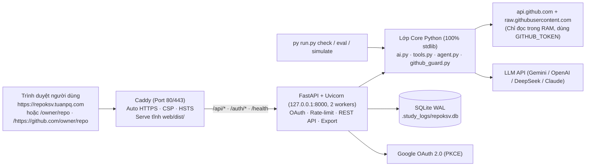

# Technical Spec Chi Tiết — RepoKSV (Hướng 1 + Hướng 2) trên AWS VPS 2 vCPU / 4 GB RAM

> **Trạng thái:** TÀI LIỆU KỸ THUẬT CHI TIẾT (CHƯA TRIỂN KHAI CODE) · **Nhánh:** `develop-tuan`  
> **Căn cứ theo:** [docs/spec-huong-1-2.md](spec-huong-1-2.md) (đã khoá), [spec.md](../spec.md) (`0edbd65`, 25 câu `S01–S25`), và vỏ Google OAuth `RepoKSV` (`repoksv.tuanpq.com`) từ nhánh `develop-tuan-web-repoksv`.

---

## 1. Tổng quan Kiến trúc Hệ thống (2 lớp độc lập)

Hệ thống tách làm **2 lớp cứng** để vừa vận hành mượt trên **AWS VPS 2 vCPU / 4 GB RAM** vừa giữ nguyên 100% khung chấm điểm của BTC (`run.py`, `eval/run_eval.py`, `cost/simulate.py`, `codebase/tracing.py`):



| Lớp | File / Thành phần | Thư viện | Ràng buộc |
|---|---|---|---|
| **Lớp Core BTC** | `codebase/ai.py`, `codebase/tools.py`, `codebase/agent.py`, `codebase/github_guard.py` | **100% Python 3.10+ stdlib** *(0 thư viện ngoài)* | `py run.py check / eval / simulate` chạy **100% offline** trên `S01..S25`; giữ nguyên hợp đồng `answer(text) -> {"output": str}` và `@model_call`; không sửa `run.py`, `tracing.py`, `eval/run_eval.py`, `cost/simulate.py`. |
| **Lớp Web & Production** | `codebase/db.py`, `codebase/exporters.py`, `codebase/server.py`, `codebase/app.py`, `web/` (`web/dist/`), `deploy/` | `fastapi`, `uvicorn[standard]`, `pydantic`, `sqlite3` (stdlib), React + Vite (build tĩnh) | Bọc ngoài Lớp Core; ghi vào `requirements.txt` cho Python. `py run.py` khởi chạy server FastAPI phục vụ `web/dist/` + `/api/*` (kèm cờ `--cli` để chạy dòng lệnh khi cần). |

---

## 2. Tương thích Google OAuth & Thương hiệu `RepoKSV` (`repoksv.tuanpq.com`)

Giữ nguyên 100% luồng xác thực và nhận diện thương hiệu đã duyệt trên nhánh `develop-tuan-web-repoksv` (`29289f1`):

- **Routes xác thực & pháp lý giữ nguyên:**
  - `GET /auth/google` (PKCE S256 + `state` random cookie `10 phút`)
  - `GET /auth/google/callback` (đổi authorization code lấy `id_token`/userinfo Google, tạo session user trong bảng `users`)
  - `POST` / `GET /auth/logout` (xoá cookie session & oauth)
  - `GET /login`, `GET /privacy`, `GET /terms`, `GET /health`
- **Biến môi trường `.env` thống nhất (gitignored, `chmod 600` trên VPS):**
  - Đã có ở `RepoKSV`: `GOOGLE_CLIENT_ID`, `GOOGLE_CLIENT_SECRET`, `SESSION_SECRET`
  - Bổ sung cho Core & GitHub: `MODEL_PROVIDER`, `MODEL_NAME`, `API_KEY`, `API_BASE_URL` (tuỳ chọn), `GITHUB_TOKEN` (Fine-grained PAT chỉ đọc public repo)
- **Cookie & Bảo mật phiên:**
  - Ký **HMAC-SHA256** (`base64url(payload).base64url(sig)`), tên `__Host-repoksv_session` khi HTTPS (hoặc `repoksv_session` ở localhost HTTP), TTL 7 ngày, cờ `HttpOnly; SameSite=Lax; Path=/` (+ `Secure` khi HTTPS).
- **Nhận diện thương hiệu & Phân quyền dùng Web:**
  - Giữ bảng màu `RepoKSV`: Navy `#1B365D`, Crimson `#9B2226`, nền giấy `#FFFFFF` / `#F8FAFC` (hỗ trợ dark mode đồng bộ bằng `light-dark()`).
  - Người dùng đăng nhập Google OAuth để định danh chủ phiên (`owner_user_id`), hưởng hạn mức riêng, lưu lịch sử `Scan Session` + `User Bloom Memory` riêng. Khi quét một repo cụ thể ở Hướng 2, vẫn giữ bước chọn *"Bạn là ai trong `TEAMS.md`?"* (nếu repo nhóm ≥ 2 người) hoặc tự mặc định (nếu repo cá nhân). *(Với chế độ demo công khai không login ở sự kiện, cho phép cấu hình biến môi trường `ALLOW_GUEST_DEMO=true` để khách thử tối đa 3 lượt/IP/ngày bằng session khách.)*

---

## 3. Thiết kế Hướng 1 — GitHub Live Guard (`codebase/github_guard.py`)

### 3.1. Hợp đồng phân tích đầu vào & Chống SSRF
- `parse_github_target(text: str) -> dict | None`:
  - Hỗ trợ mọi biến thể: `https://github.com/owner/repo`, `github.com/owner/repo`, `repoksv.tuanpq.com/owner/repo`, `repoksv.tuanpq.com/https://github.com/owner/repo`, đường dẫn URL-hack `/owner/repo` hoặc `/https://github.com/owner/repo`.
  - **Chặn SSRF cứng:** Không bao giờ gửi HTTP request tới URL do user nhập. Chỉ trích cặp `(owner, repo)` khớp regex `^[A-Za-z0-9_.-]{1,100}$`, cấm `..`, loại trừ các route nội bộ (`api`, `auth`, `login`, `privacy`, `terms`, `health`, `assets`, `static`, `favicon.ico`, `robots.txt`), rồi **hardcode** chỉ gọi 2 host: `https://api.github.com` và `https://raw.githubusercontent.com`.

### 3.2. Bốn lớp kiểm tra tất định (`fetch_github_repo_snapshot`)
Mọi request gửi header bắt buộc `User-Agent: RepoKSV-Auditor/1.0`, `Accept: application/vnd.github+json` (và `Authorization: Bearer <GITHUB_TOKEN>` nếu có).

1. **`PUBLIC-ACCESS`:** `GET /repos/{owner}/{repo}` → xác nhận `private == false`. Gặp `404` hoặc `403` (không phải rate limit) → trả cờ G10 `PRIVATE_OR_NOT_FOUND` *"Không truy cập được ở chế độ công khai (repo Private hoặc sai link)"*.
2. **`GIT-FORK-PR`:** Đọc `fork` + `parent.full_name`; nếu là fork từ repo đề → gọi `GET /repos/{parent}/pulls?state=open&per_page=30` lọc `head.user.login == owner` hoặc `head.repo.full_name == f"{owner}/{repo}"` → gắn cờ đỏ `GIT-FORK-PR` kèm số PR `#N`.
3. **`PENALTY-STANDARD` (Anti-Tamper sau 19:30 CP2 — 0đ R4):** Gọi `GET /repos/{owner}/{repo}/commits?since=2026-11-27T12:30:00Z&per_page=15` trên 3 path:
   - `eval/metric_spec.yaml`: bất kỳ commit nào chạm vào → bật cờ `PENALTY-STANDARD` kèm `SHA` + thời gian.
   - `spec.md`: đọc `patch` ở `/commits/{sha}`, chỉ bật cờ nếu có dòng xoá/sửa (`-`) đụng mục `§7` / `Chuẩn "đạt"` (cho phép cập nhật `§10` changelog).
   - `eval/benchmark.csv`: đọc `patch`, chỉ bật cờ nếu có dòng xoá (`-S\d+` hoặc `-id,`) câu thử cũ (thêm dòng mới cho CP3 hợp lệ).
4. **`PENALTY-KEY` cây file & Tải file qua `raw.githubusercontent.com` vào RAM:**
   - `GET /repos/{owner}/{repo}/git/trees/{default_branch}?recursive=1` bắt `(^|/)\.env(\..+)?$` (trừ `.env.example`), `\.pem$`, `(^|/)id_rsa$`, `*credentials*.json`, `*service-account*.json`.
   - Đọc danh sách file nộp chuẩn (`TEAMS.md`, `canvas.md`, `spec.md`, `evidence/summary.md` hoặc `evidence_summary.md`, `eval/benchmark.csv` hoặc `benchmark.csv`, `eval/metric_spec.yaml` hoặc `metric_spec.yaml`, và tối đa 5 file `reflection/*.md`) qua `raw.githubusercontent.com` *(0 tốn quota API)* vào RAM, giới hạn **`200 KB/file`**, tuyệt đối **không ghi code đội khác xuống đĩa**.

### 3.3. Chiến lược Cache & Fallback khi dính `403/429`
- **Cache 5–10 phút** theo `(owner.lower(), repo.lower(), commit_sha)` (RAM ở Core / bảng `github_cache` ở SQLite).
- Nếu `api.github.com` trả `403` (`X-RateLimit-Remaining: 0`) hoặc `429`: đọc header `Retry-After` / `X-RateLimit-Reset`; thực hiện fallback kéo trực tiếp các file nộp chuẩn qua `raw.githubusercontent.com/{owner}/{repo}/HEAD/...` để vẫn kiểm được nội dung file, đồng thời gắn thông báo **HAX G10** cho các mục không kiểm tra được qua API (PR upstream & lịch sử commit sau CP2).

---

## 4. Thiết kế Hướng 2 — Bộ 3 Prompt Bloom L0–L6 & Định danh Team/Cá nhân

### 4.1. Tự nhận diện Project Nhóm vs Cá nhân (`extract_project_identity`)
- Parse bảng thành viên `TEAMS.md` + đoạn phân công `spec.md` §10 + file `reflection/*.md`:
  - `len(members) >= 2` → `mode = "team"`, `default_user = None` (Web/CLI hiển thị danh sách chọn *"Bạn là ai trong team?"*).
  - `len(members) == 1` → `mode = "personal"`, `default_user = members[0].name`.
  - Không có `TEAMS.md` hoặc `0` dòng hợp lệ → `mode = "personal"`, `default_user = github_owner` (hoặc `"Người dùng cá nhân"`).

### 4.2. Xử lý từ chối 2 tầng (Fix triệt để `S25`) & Trích dẫn có `/`
- **Từ chối cứng (`hard_refusals` — trả lời từ chối ngay, 0 gọi model):** xin chấm điểm `/100`, xin bịa phiếu phỏng vấn/khảo sát, xin sửa chuẩn đạt/xoá câu thử sau CP2 (`S15`).
- **Từ chối hành động sửa/push (`action_refusals` — fix `S25`):** các yêu cầu đòi AI *"tự động sửa / sửa hết lỗi / commit / push / tạo PR"*. Nếu trong input có `SUBMISSION_ID` hoặc link GitHub hợp lệ → chèn khung `[TỪ CHỐI TỰ SỬA / COMMIT / PUSH]` ở đầu output **VÀ tiếp tục chạy quy trình 3 bước** để liệt kê đầy đủ lỗi thật kèm `file:Lxx`.
- **`verify_audit_output` regex mới:** hỗ trợ đường dẫn có `/` (`evidence/summary.md:L12`, `eval/benchmark.csv:L05`, `reflection/tuan.md:L03`); chặn tuyệt đối điểm cuối `\d{1,3}/100` (`NO-AUTO-GRADE`) nhưng **không chặn nhầm** thang thông hiểu Bloom `Level X/6`.

### 4.3. Đặc tả Bộ 3 Prompt Bloom L0–L6 (`codebase/agent.py`)
*(Tham khảo trực tiếp `packs/ai-agent-mastery.pack.json` L27/36/41/46, `types/free/type.json` L42, và `FEEDBACK_STYLE` trong `src/core/ai.ts` L205 từ `C:\PROJECT\_Tools\_etude` — giữ `answer(text)` stateless, 1 lượt `@model_call`):*

1. **`SYSTEM_VIVA_ASK` (`VIVA_ASK | TARGET: <Tên> | TOPIC: <tuỳ chọn> | <nguồn>`):**
   - Sinh 1 câu hỏi xoáy đúng phần việc của `<Tên>` theo 3 tầng: `L1–L2` (*Feynman & Contrast*: tự giải thích cơ chế, phân biệt khái niệm gần nghĩa) · `L3–L4` (*Thực chiến & Trade-off*: lý do chọn thiết kế, điều kiện biên) · `L5` (*Bằng chứng*: đối chiếu số liệu `file:Lxx`).
   - Bắt buộc xuất kèm khối JSON ẩn cuối phản hồi (tầng Web tách ra cất, **che khỏi màn hình user trước khi trả lời**):
     ```json
     [VIVA_META_JSON]
     {"concept_key":"...", "term":"...", "tag":"noi_dung|khai_niem|phan_bien", "source_cite":"spec.md:L68", "reference":"...", "rubric":"...", "common_misconceptions":["..."]}
     [/VIVA_META_JSON]
     ```
2. **`SYSTEM_VIVA_DEFENSE` (`VIVA_DEFENSE | TARGET: <Tên> | QUESTION: ... | ANSWER: ... | <nguồn>`):**
   - Bọc toàn bộ repo lẫn chuỗi `ANSWER:` trong `<submission_data_untrusted>` + quét regex injection trên `ANSWER:` để chặn hành vi tự công nhận đạt 100%.
   - Không chấp nhận học vẹt từ khoá; chẩn đoán theo **Bloom `L0–L6`** *(chỉ đo mức thông hiểu để cá nhân hoá học tập, tuyệt đối cấm `/100`)* và trả đúng **4 mục**:
     1. **Mức đạt Bloom:** `Level X/6 — <Tên bậc>` + lý do ngắn & thiếu gì để lên `X+1`.
     2. **Điểm đã trúng / Còn thiếu:** bám chặt `file:Lxx`.
     3. **Ngộ nhận / Lệch số liệu + Bản chất:** giải thích ngắn 2–3 câu gốc rễ *(không viết hộ bài văn mẫu)*.
     4. **Câu hỏi nâng bậc (`+1 Bloom`)** + khối dữ liệu nháp (chờ user bấm Lưu xác nhận mới ghi DB):
        ```json
        [BLOOM_LOG_DRAFT_JSON]
        {"concept_key":"...", "term":"...", "tag":"...", "source_cite":"...", "bloom_level":2, "understood_points":["..."], "missing_points":["..."], "misconceptions":["..."], "resolved_misconceptions":["..."], "next_probe":"...", "reference":"...", "rubric":"..."}
        [/BLOOM_LOG_DRAFT_JSON]
        ```
3. **`SYSTEM_VIVA_COACH` (`VIVA_COACH | TARGET: <Tên> | GOAL: ... | MEMORY: <tóm tắt> | <nguồn>`):**
   - Đọc `BLOOM_MEMORY` do backend nạp từ `bloom_profiles` của `<Tên>`. Bỏ qua các khái niệm đã đạt `L4–L6`; xếp ưu tiên gỡ `L0–L1` (vướng `misconceptions`) → đẩy `L2` lên `L3–L4` → đẩy `L4` lên `L5–L6`, rồi bắn **1 câu hỏi nâng bậc `+1 Bloom`** kèm `[VIVA_META_JSON]`.

---

## 5. Thiết kế Database SQLite WAL (`codebase/db.py`, `.study_logs/repoksv.db`)

Cấu hình mỗi kết nối SQLite:
```sql
PRAGMA journal_mode=WAL;
PRAGMA synchronous=NORMAL;
PRAGMA busy_timeout=5000;
PRAGMA foreign_keys=ON;
```

```sql
CREATE TABLE IF NOT EXISTS users (
  user_id TEXT PRIMARY KEY,
  google_sub TEXT UNIQUE,
  email TEXT NOT NULL DEFAULT '',
  display_name TEXT NOT NULL DEFAULT '',
  picture_url TEXT NOT NULL DEFAULT '',
  created_at TEXT NOT NULL
);

CREATE TABLE IF NOT EXISTS scan_sessions (
  scan_id TEXT PRIMARY KEY,
  owner_user_id TEXT NOT NULL REFERENCES users(user_id),
  source_type TEXT NOT NULL,         -- 'local' | 'github'
  source_label TEXT NOT NULL,        -- 'S04' | 'owner/repo'
  commit_sha TEXT NOT NULL DEFAULT '',
  mode TEXT NOT NULL,                -- 'team' | 'personal'
  members_json TEXT NOT NULL DEFAULT '[]',
  audit_output TEXT NOT NULL,
  hard_flags_json TEXT NOT NULL DEFAULT '[]',
  checks_json TEXT NOT NULL DEFAULT '{}',
  missing_required_json TEXT NOT NULL DEFAULT '[]',
  line_counts_json TEXT NOT NULL DEFAULT '{}',
  tracing_json TEXT NOT NULL DEFAULT '{}',
  created_at TEXT NOT NULL
);
CREATE INDEX IF NOT EXISTS idx_scans_owner_time ON scan_sessions(owner_user_id, created_at DESC);
CREATE INDEX IF NOT EXISTS idx_scans_label ON scan_sessions(owner_user_id, source_label, created_at DESC);

CREATE TABLE IF NOT EXISTS viva_entries (
  id INTEGER PRIMARY KEY AUTOINCREMENT,
  scan_id TEXT NOT NULL REFERENCES scan_sessions(scan_id) ON DELETE CASCADE,
  member_slug TEXT NOT NULL,
  member_name TEXT NOT NULL,
  mode TEXT NOT NULL,                -- 'ask' | 'defense' | 'coach'
  concept_key TEXT NOT NULL DEFAULT '',
  question TEXT NOT NULL DEFAULT '',
  answer TEXT NOT NULL DEFAULT '',
  ai_feedback TEXT NOT NULL DEFAULT '',
  bloom_level INTEGER,
  draft_json TEXT NOT NULL DEFAULT '{}',
  saved_by_user INTEGER NOT NULL DEFAULT 0,
  created_at TEXT NOT NULL
);
CREATE INDEX IF NOT EXISTS idx_viva_scan_member ON viva_entries(scan_id, member_slug);

CREATE TABLE IF NOT EXISTS bloom_profiles (
  owner_user_id TEXT NOT NULL REFERENCES users(user_id),
  member_slug TEXT NOT NULL,
  concept_key TEXT NOT NULL,
  term TEXT NOT NULL DEFAULT '',
  tag TEXT NOT NULL DEFAULT 'khai_niem',
  source_cite TEXT NOT NULL DEFAULT '',
  bloom_level INTEGER NOT NULL DEFAULT 0,
  highest_bloom_level INTEGER NOT NULL DEFAULT 0,
  understood_json TEXT NOT NULL DEFAULT '[]',
  missing_json TEXT NOT NULL DEFAULT '[]',
  misconceptions_json TEXT NOT NULL DEFAULT '[]',
  resolved_misconceptions_json TEXT NOT NULL DEFAULT '[]',
  next_probe TEXT NOT NULL DEFAULT '',
  prompt TEXT NOT NULL DEFAULT '',
  reference TEXT NOT NULL DEFAULT '',
  rubric TEXT NOT NULL DEFAULT '',
  status TEXT NOT NULL DEFAULT 'needs_review',  -- 'needs_review' | 'mastered'
  history_json TEXT NOT NULL DEFAULT '[]',
  updated_at TEXT NOT NULL,
  PRIMARY KEY (owner_user_id, member_slug, concept_key)
);

CREATE TABLE IF NOT EXISTS github_cache (
  cache_key TEXT PRIMARY KEY,        -- 'owner/repo'
  commit_sha TEXT NOT NULL DEFAULT '',
  payload_json TEXT NOT NULL,
  expires_at INTEGER NOT NULL
);

CREATE TABLE IF NOT EXISTS rate_limit_events (
  bucket_key TEXT PRIMARY KEY,       -- 'ip:<addr>:scan' | 'user:<id>:llm'
  window_start INTEGER NOT NULL,
  count INTEGER NOT NULL
);
```
> **Quyền riêng tư:** Không lưu nguyên mã nguồn/nội dung bài nộp của repo đội khác xuống SQLite; chỉ lưu kết quả kiểm toán, dòng trích dẫn `file:Lxx` ngắn và hồ sơ Bloom của người dùng.

---

## 6. Hợp đồng REST API, URL-Hack & 4 Định dạng Export (`codebase/server.py`)

### 6.1. Bảng Endpoints
| Method & Path | Chức năng | Ghi chú / Rate-limit |
|---|---|---|
| `GET /health` | Trạng thái server + OAuth + model provider | Công khai |
| `GET /auth/google` · `/auth/google/callback` · `/auth/logout` | Google OAuth 2.0 PKCE + cookie HMAC-SHA256 | Giữ nguyên hợp đồng `RepoKSV` |
| `GET /api/me` | Trả user đang đăng nhập (hoặc cấu hình guest demo) | Trả `401` nếu chưa login & tắt guest |
| `GET /api/submissions` | Danh sách hồ sơ mẫu `S01..S25` đọc từ `data/submissions/` | Không tốn token |
| `POST /api/scan` | Body `{target, force_refresh?}` → soi GitHub URL hoặc `SXX`, lưu `ScanSession`, trả kết quả + so sánh phiên trước | Giới hạn `<= 5 req/phút/IP`; dùng cache `(repo, sha)` nếu chưa đổi commit |
| `GET /api/sessions` | Danh sách các lần quét của `owner_user_id` | Mới nhất trước |
| `GET /api/sessions/{scan_id}` | Chi tiết phiên + `viva_entries` của phiên đó | Kiểm tra đúng `owner_user_id` |
| `GET /api/sessions/{scan_id}/diff` | So sánh số lỗi cứng & bậc Bloom với lần quét trước của cùng repo | Tính trực tiếp từ SQLite |
| `GET /api/sessions/{scan_id}/file-lines?file=...&line=...` | Trả nội dung đánh số `L01..` từ `SXX` hoặc RAM cache GitHub để mở modal trích dẫn | Kiểm chặt path hợp lệ, không đọc ngoài phạm vi |
| `POST /api/viva/ask` | `{scan_id, member_name, topic?}` → sinh câu hỏi + tách ẩn `[VIVA_META_JSON]` ở server trước khi trả về client | Giới hạn `<= 30 lượt LLM/user/ngày` |
| `POST /api/viva/defense` | `{scan_id, member_name, question, answer, viva_meta?}` → chẩn đoán Bloom + trả `[BLOOM_LOG_DRAFT_JSON]` chờ duyệt | Giữ cứng `NO-AUTO-GRADE` |
| `POST /api/viva/coach` | `{scan_id, member_name, goal?}` → đọc `bloom_profiles` của user đó, tư vấn lộ trình & bắn câu nâng bậc `+1 Bloom` | 1 lượt `@model_call` |
| `POST /api/study/confirm-log` | User bấm **Lưu vào hồ sơ** → đánh dấu `saved_by_user=1` & gộp vào `bloom_profiles` (`misconceptions` → `resolved_misconceptions`) | Đúng nguyên tắc human-in-the-loop |
| `POST /api/study/card-status` | `{scan_id, member_name, concept_key, status}` (`needs_review` \| `mastered`) | Cập nhật hàng đợi ôn trên web |
| `GET /api/profiles/{member_slug}` | Hồ sơ Bloom xuyên suốt của thành viên (mức từng khái niệm + lịch sử tăng bậc) | Chỉ trả của `owner_user_id` |
| `GET /api/export/{fmt}?scan_id=...&member=...` | `fmt` thuộc `anki` \| `md` \| `etude` \| `json` → trả file tải về (`Content-Disposition: attachment`) | 100% Python stdlib |
| `GET /{owner}/{repo}` · `/https://github.com/{owner}/{repo}` | Serve `web/dist/index.html` (SPA đọc `window.location.pathname` để tự động kích hoạt `/api/scan`) | Cho phép bookmark/dán URL-hack |

### 6.2. Đặc tả 4 Định dạng Export (`codebase/exporters.py`)
1. **Anki (`.tsv` chuẩn Anki 2.1+):** đầu file `#separator:tab`, `#html:true`, `#tags column:3`, mỗi dòng `Front\tBack\tTags` (lọc `bloom_level <= 2` hoặc còn `misconceptions`/`missing_points`, escape HTML & thay `\n` thành `<br>`).
2. **Markdown (`.md` — `study-guide-<user>.md`):** gom 3 nhóm ưu tiên `L0–L1` → `L2` → `L3+`, kèm `source_cite`, bản chất, ngộ nhận cần tránh và câu nâng bậc.
3. **Etude Pack (`.pack.json`):** chuẩn `"etude": "pack/1"`, `decks[0].instructions` tiếng Việt Bloom 6 bậc, `items` dùng `"type": "free"` (`prompt`, `reference`, `rubric`, `explanation`).
4. **JSON Phiên quét (`.json`):** toàn bộ `scan_session` + `viva_entries` của phiên đó.

---

## 7. Kiến trúc Frontend React + TypeScript + Vite (`web/` → `web/dist/`)

- **Cấu trúc module gọn trên nhánh `develop-tuan`:**
  - `web/src/api/client.ts` (fetch wrapper kèm `credentials: "include"`, xử lý lỗi HTTP `401`/`429`).
  - `web/src/components/TopBar.tsx` (ô nhập URL GitHub / `S01..S25`, badge tài khoản Google OAuth / Logout, nút đổi theme Sáng/Tối/Hệ thống).
  - `web/src/components/ScanSidebar.tsx` (lịch sử `Scan Session` bên trái, badge delta lỗi cứng so với lần trước).
  - `web/src/components/AuditPanel.tsx` (4 thẻ trạng thái GitHub sống, danh sách lỗi cứng, báo cáo AI biến mọi `file:Lxx` thành chip bấm được).
  - `web/src/components/CiteDialog.tsx` (`<dialog closedby="any">` chuẩn `light-dismiss-a-dialog` kèm fallback click ngoài hộp cho Safari, tô sáng đúng dòng `Lxx`).
  - `web/src/components/VivaStudyPanel.tsx` (chọn danh tính *"Bạn là ai?"*, hồ sơ Bloom xuyên suốt, nút *Hỏi vặn* / *Tư vấn nâng bậc Bloom*, thẻ luyện che đáp án kiểu `_etude`, nút *Xác nhận lưu*, *Thử lại*, *Lật giải thích*, *Chưa vững / Đã hiểu*).
  - `web/src/components/ExportPanel.tsx` (xem trước & tải 4 định dạng Anki / Markdown / Etude / JSON).
- **Tuân thủ `modern-web-guidance` & Bảo mật XSS:**
  - `<meta name="color-scheme" content="light dark">` + inline script chống nháy sáng (FOUC) đọc `localStorage` + CSS `:root:has(...)` + `light-dark(...)`.
  - Tabs chuẩn `role="tablist"` / `aria-selected` + đường gạch chân `border-block-end: 3px solid` (không phân biệt chỉ bằng màu) + `hidden="until-found"` kèm wrapper padding bên trong.
  - Tuyệt đối không chèn HTML thô từ nội dung repo vào DOM (`textContent` / Sanitizer `setHTML()` + fallback escape chặt).

---

## 8. Ma trận 7 Rủi ro Production & Bằng chứng kiểm chứng

Đã đo kiểm thực tế từ máy local tới GitHub API ngày 28/11/2026 (`phamtuan2xx3-alt/K5-Day15-L3B-Free2Play`):
- `GET api.github.com/repos/...` *(không token)*: `200 OK` (482ms) · **`X-RateLimit-Limit: 60` req/giờ/IP** (4–5 call/repo → ~12 repo/giờ).
- `GET raw.githubusercontent.com/.../TEAMS.md`: **`200 OK` (527ms)** · **`X-RateLimit-Remaining: None`** (0 tốn quota API).
- `GET api.github.com/repos/.../khong-ton-tai`: `404 Not Found` (461ms).

| # | Rủi ro | Mức | Giải pháp kỹ thuật | Cách kiểm chứng rõ ràng |
|---|---|---|---|---|
| 1 | GitHub chặn bot / cạn quota `60 req/hr` trên AWS IP (`403/429`) | Rất cao | Không scrape HTML; bắt buộc `User-Agent`; dùng **`GITHUB_TOKEN`** read-only (`5.000 req/hr` theo tài khoản); kéo file qua `raw.githubusercontent.com`; cache theo `(repo, commit_sha)`; fallback `raw` + báo G10 khi `403/429`. | Unit test mock đủ `200 / 404 / 403 rate-limit / 429 Retry-After` + smoke test live với PAT trên VPS. |
| 2 | SSRF dò AWS EC2 Metadata (`169.254.169.254`) qua URL-hack | Rất cao | Chỉ parse `(owner, repo)` khớp regex `^[A-Za-z0-9_.-]{1,100}$`, hardcode 2 host `api.github.com` & `raw.githubusercontent.com`; bật bắt buộc **EC2 IMDSv2**. | Unit test truyền IP nội bộ, `file://`, `../..` → chặn trước khi mở kết nối mạng. |
| 3 | Spam API đốt tiền LLM khi mở web công khai | Cao | Google OAuth + FastAPI rate-limit (`<= 5 quét/phút/IP`, `<= 30 LLM/user/ngày`) + cache `(repo, sha)` 0 token khi quét lại + cắt 120 dòng/file. | Test gửi >5 request/phút → HTTP `429`; quét lại cùng commit → `model_calls = 0`. |
| 4 | Prompt Injection & XSS từ nội dung repo lạ | Cao | Bọc repo + `ANSWER:` trong `<submission_data_untrusted>`, `verify_audit_output` khoá cờ cứng; frontend render bằng text/Sanitizer API + CSP từ Caddy. | Chạy `S14`, `S24` + payload `` → 0 script chạy, 0 cờ bị xoá. |
| 5 | Race condition / treo server khi nhiều đội bấm cùng lúc | Trung bình | FastAPI + Uvicorn (2 workers) + timeout 10s/45s + **SQLite WAL (`busy_timeout=5000`)**. | Load test 15 thread ghi đọc đồng thời vào SQLite → 0 lỗi `locked`, RAM <300MB. |
| 6 | Repo Private / nhánh khác `main` / file >200KB | Trung bình | Đọc `default_branch` động từ API; giới hạn `200KB/file`; gặp `404` báo **HAX G10** rõ lý do. | Mock test nhánh `master`, file 300KB, repo `404` → không crash, báo G10 chuẩn. |
| 7 | Sửa web làm gãy khung chấm `py run.py eval` / `simulate` | Cao | Lớp Core giữ 100% Python stdlib & `S01..S25` chạy offline hoàn toàn độc lập với FastAPI/SQLite/React. | Cổng kiểm bắt buộc: `py run.py check`, `eval --fake`, `eval --try`, `simulate --try` pass 100%. |

---

## 9. Hạ tầng Deploy trên AWS VPS (2 vCPU / 4 GB RAM)

- **Phân bổ tài nguyên dự kiến:** Caddy (~30MB) + 2 Uvicorn workers (~140MB) + SQLite WAL (0MB nền) ≈ **~170–250MB / 4 GB RAM** (còn dư >3.5 GB).
- **Cấu hình mạng & bảo mật:**
  - EC2 Security Group & `ufw`: chỉ mở `22` (SSH theo IP admin), `80`, `443`; cổng `8000` chỉ listen `127.0.0.1`.
  - EC2 Metadata: bật bắt buộc **IMDSv2** (`http-tokens=required`).
  - File `.env`: đặt tại thư mục app với quyền `chmod 600`.
- **File cấu hình triển khai chuẩn (`deploy/`):**
  - `deploy/Caddyfile`: phục vụ `repoksv.tuanpq.com`, tự cấp TLS, chèn security headers (HSTS, `X-Content-Type-Options: nosniff`, `Referrer-Policy`, CSP), proxy `/api/*`, `/auth/*`, `/health`, `/login`, `/privacy`, `/terms` về `127.0.0.1:8000`, và serve tĩnh `web/dist/` kèm fallback `/index.html` cho mọi URL-hack `/{owner}/{repo}`.
  - `deploy/repoksv.service` (`systemd`): chạy `uvicorn codebase.server:app --host 127.0.0.1 --port 8000 --workers 2`, `Restart=always`, `EnvironmentFile=/opt/repoksv/.env`.
